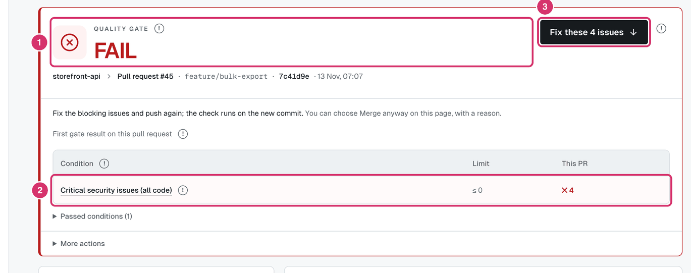

# Skylos rule handbook sources

The rule handbook is a printable PDF: one page (or a few) per rule, saying
what the rule finds, why it matters, what flagged and not-flagged code looks
like, how Skylos decides, how to fix it and how to silence it.

Everything here is source. `scripts/build_handbook.py` turns it into one HTML
file and prints that to PDF with headless Chrome.

| Path | What it holds |
|:--|:--|
| `rules/<RULE-ID>.yaml` | One rule page. The file name is the rule ID. |
| `families.yaml` | The book's rule families: title, ID prefixes, intro, and which catalog rules belong to each. |
| `intro/NN-name.md` | Front matter chapters, in file-name order. |
| `cloud/NN-name.md` | The "Using Skylos Cloud" guide, printed after the front matter. |
| `cloud/manifest.yaml` | Every Cloud destination, the guide section that covers it, and the Cloud commit the guide was checked against. |
| `cloud/capture/` | Scripts that seed a local Cloud with fictional data and retake the screenshots (see its README). |
| `img/cloud/*.png` | The guide's screenshots. |
| `pending.yaml` | Catalog rules that have no page yet, each with a reason. |
| `batches.json` | The unwritten rules split into six batches for parallel writing. |
| `handbook.css` | Page style (A4, `@page` margins, footer page numbers). |

The rule list itself comes from `skylos/rules/catalog.py`. Every catalog rule
needs a page or an entry in `pending.yaml`; the build (`--check` included)
and `test/test_handbook_coverage.py` fail otherwise, so a new rule cannot be
added without one or the other. A pending rule is "not yet written": the
coverage report lists it and a pilot build leaves it out. Go engine IDs that
Skylos reports under a shared rule (SKY-G211 is reported as SKY-D211, see
`skylos/visitors/languages/go/go.py`) need neither: they are shown on the
shared rule's page.

The appendix "Command and flag reference" and the "Commands at a glance"
table are generated at build time from the CLI's own parsers
(`skylos/cli_core/main_parser.py`, the agent parser and every command whose
`--help` is argparse) and its help table (`skylos/ui/help.py`). New commands
and flags appear without hand edits.

## The Skylos Cloud guide

The chapters in `cloud/` use the same Markdown subset as `intro/`, plus one
line form for a screenshot:

```markdown

```

The image must be a PNG or JPEG under `img/`. The build embeds it in the
HTML (base64), so the PDF needs no other file. Keep images under about
150 KB: `cloud/capture/optimize.py` trims, scales and reduces each capture.

`{{cloud_verified}}` prints "Verified against Skylos Cloud <commit>, <date>"
from `cloud/manifest.yaml`. Every feature in the manifest names the chapter
and the `##`/`###` heading that covers it; the build (`--check` included)
and `test/test_handbook_coverage.py` fail when one has no section, when a
referenced image is missing, or when the manifest has no verified commit.
With `SKYLOS_CLOUD_REPO=<Cloud checkout>` the test also fails when Cloud has
a sidebar, settings or project destination the manifest does not list, or
when the checkout is not at the verified commit. Retake the screenshots and
update the manifest for each Cloud release (`cloud/capture/README.md`).

## Build

Use a Python that has PyYAML and Pygments (the Skylos development
environment has both) and Google Chrome or Chromium.

```bash
python scripts/build_handbook.py --check              # validate pages, write the coverage report
python scripts/build_handbook.py --verify-only        # run every example through skylos
python scripts/build_handbook.py --verify             # verify, then build the PDF
python scripts/build_handbook.py --output out/handbook.pdf
python scripts/build_handbook.py --rule SKY-D211 --verify   # one page
python scripts/build_handbook.py --mode full          # refuses to build while any rule has no page
```

Next to the PDF it writes `<name>.html`, `<name>-coverage.md` and, with
`--verify`, `<name>-verify.json`, and nothing else in the repository; scratch
folders and the Chrome profile are temporary. The default output is
`build/handbook/skylos-handbook.pdf` (git-ignored). Builds with different
`--output` paths can therefore run in parallel, which is how one rule is
checked while other pages are being written:

```bash
python scripts/build_handbook.py --rule SKY-D212 --verify-only \
  --output build/handbook-batch/SKY-D212/handbook.pdf
```

Go examples need a `skylos-go` engine built from the same checkout: the
binary committed under `skylos/engines/go/` can lag behind the Go source and
only runs on one platform. Build one (`cd skylos/engines/go && go build -o
skylos-go ./cmd/skylos-go`) or point `SKYLOS_GO_BIN` at one.

With `--rule`, the pending check is skipped and the coverage report only
counts the selected pages. On CI runners where Chrome's sandbox is not
available, add `--chrome-arg=--no-sandbox`.

Chrome is found at the macOS default path, on `PATH`
(`google-chrome`, `chromium`), or through `--chrome` / `CHROME_BIN`. The
build prints twice: the first pass finds the page of every anchor (from the
PDF's named destinations), the second writes those numbers into the contents,
family tables and index.

## `--verify`

Each example is written into its own folder under a scratch directory and the
real CLI runs on it:

```text
skylos . <flags> --no-upload --format json --output <file>
```

- The `skylos` used is the console script next to the running Python (or
  `--skylos`), with this checkout first on `PYTHONPATH`. The report records
  the version and the imported module path.
- `HOME`, `XDG_*` and Git identity point at the scratch folder. Only `PATH`,
  locale, temp variables and `SKYLOS_GO_BIN` are passed through, so tokens, API keys and CI
  variables never reach the scan. `SKYLOS_CUSTOM_RULES='[]'` stops the scan
  from fetching Cloud custom rules.
- `<flags>` are the analysis flags `skylos --select <RULE-ID>` would turn on
  (for example `--danger` for SKY-D rules, `--quality` for SKY-L rules,
  nothing for unused-code rules). A git_diff example adds `--diff HEAD`. An
  example's `scan_flags` replaces all of them.
- A flagged example passes when the rule ID is reported (and, with
  `expect_line`, reported on that line). A not-flagged example, and a fix
  that has a `filename`, pass when the rule ID is not reported. Exit code 2,
  any entry in the scan's `analysis_errors` (a file or check that was not
  analysed) or missing JSON fails the check, so an example Skylos could not
  read never passes as "not reported".
- Each suppression item with a `check` is verified too (see below).
- An example, or a whole page, marked `verify: {mode: manual, reason: ...}`
  is not run. The report lists it as "manual", the coverage report counts
  it, and the PDF prints "Example not machine-checked: <reason>" under it.
  Use it only when one offline scan cannot reproduce the rule: rules that
  only `skylos done` runs, and rules that need a package registry, OSV or
  another network service.
- `--keep-scratch` keeps the folders; `--scratch DIR` picks the folder.

A passing check is printed under its example in the PDF ("Checked. Skylos
5.4.0, `skylos . --danger`: reported at app/users.py line 13."). The note
only appears while the example, its flags and the rule are unchanged since
the last `--verify`.

## Rule page schema

```yaml
id: SKY-D211                # must match the file name and the catalog
gate:                        # what the quality gate does with a finding
  full: critical_blocks      # full scan: counted | critical_blocks | listed | blocks | not_run
  diff: counted              # optional; diff scans, when different from full
  opt_in: ...                # optional: a setting the rule needs before it runs
  note: ...                  # optional text
title: SQL injection         # plain title; the catalog name is shown if it differs
family: security             # an id from families.yaml
severity: CRITICAL           # must equal the catalog severity when it has one;
                             # otherwise CRITICAL, HIGH, MEDIUM, LOW, VARIES or UNRATED
severity_note: ...           # optional; required for VARIES and UNRATED
languages: [Python, Go]      # display names
cwe: [CWE-89]                # optional; must equal the catalog. The PDF always
                             # prints the catalog's CWE list.
run_with: ...                # optional; overrides the "Turned on by" line

what_it_is: ...              # 2-3 plain sentences
why_it_matters: ...          # 1-3 sentences, a concrete consequence
how_skylos_decides:          # the detector's real logic, in order
  - Finds ...
  - Skips ...
source_refs:                 # for maintainers; checked on every build
  - path: skylos/rules/danger/danger_sql/sql_flow.py
    symbol: "class _SQLFlowChecker"   # must occur in that file
    note: optional text

flagged_example: <example>
not_flagged_example: <example>   # plus `why`: why Skylos correctly ignores it
more_examples:               # optional: more languages, each pair verified
  - flagged: <example>
    not_flagged: <example>   # with `why`
verify:                      # optional: the whole page cannot be checked offline
  mode: manual
  reason: only skylos done runs this rule

fix:
  explanation: ...
  code: |                    # optional
    ...
  filename: app/users.py     # optional; with a filename the fix is verified
  language: python           # optional; defaults to the flagged example's
  scan_flags: [...]          # optional, as for examples

false_alarms_and_suppression:
  misfires:                  # when the rule can be wrong
    - ...
  suppress:                  # how to silence it; code is optional
    - text: ...
      code: |
        cur.execute(sql)  # skylos: ignore[SKY-D211] reason
      language: python
      check: inline          # optional, see "Checking suppression claims"

related: [SKY-D217, SKY-D212]    # catalog IDs
```

### Gate states

`gate.full` (and `gate.diff` when a diff scan behaves differently) is one of:

| State | Meaning | Typical rules |
|:--|:--|:--|
| `counted` | Counts toward a `[tool.skylos.gate]` limit (`max_security`, `max_quality`, `max_ai_defects`, `max_dead_code` and so on). | Most quality, logic and AI-code rules |
| `critical_blocks` | Counted, and a CRITICAL finding fails the gate on its own. | Security rules that can report CRITICAL |
| `listed` | Reported, but no limit counts it. | Agent and publish-job rules in full scans |
| `blocks` | Fails the gate on its own, whatever the limits. | Secrets; agent hooks in diff scans |
| `not_run` | The rule does not run in that kind of scan. | Diff-only rules in full scans |

Read the answer from `skylos/core/gatekeeper.py` (`_gate_issue_groups`,
`FULL_SCAN_REPORT_ONLY_RULES`, `CHANGE_BLOCKING_RULES`,
`REPORT_ONLY_DEPENDENCY_RULES`), not from the docs. `opt_in` says what must be
configured before the rule runs at all, for example
`min_release_age_hours` under `[tool.skylos.supply_chain]`.

### Checking suppression claims

A `suppress` item can carry a `check`. The build then proves the claim
against the flagged example:

| `check` | What the build does | Passes when |
|:--|:--|:--|
| `inline` | Appends `# skylos: ignore[RULE] handbook check` (or `//` for C-like languages) to the flagged example's reported line (`expect_line` is required). | The rule is no longer reported. |
| `config` | Adds a `pyproject.toml` with `[tool.skylos] ignore = ["RULE"]`. | The rule is no longer reported. |
| `baseline` | Runs `skylos baseline .`, then scans with `--baseline`. | The rule is no longer reported. |
| `{kind: example, example: <example>}` | Scans the given example, for markers on other lines or files. | The rule is not reported. |

Add `expect: reported` to the mapping form, for example
`check: {kind: config, expect: reported}`, to prove that a method does
**not** work. A `check` that passes prints a "Checked" line under the item.
TSX, JSX and JSON have no line comment the build can append; use the
`example` form there.

Text fields accept a small inline Markdown subset: `` `code` ``,
`**bold**` and `[text](url)`. Rule IDs that have a page become links.

### Fragments: keeping example secrets out of this repository

Skylos scans its own repository, so a page that shows a real-looking secret
would be a real finding. Store such values in parts and refer to them with
`{{NAME}}`:

```yaml
fragments:
  STRIPE_DEMO_KEY: ["sk_live_", "51HandbookDemo0nly"]

flagged_example:
  code: |
    STRIPE_SECRET_KEY = "{{STRIPE_DEMO_KEY}}"
```

The build joins the parts and replaces `{{NAME}}` in every text and code
field before validating, printing and verifying. Names are upper case.

### Examples

An example is one file:

```yaml
flagged_example:
  language: python
  filename: app/users.py
  expect_line: 13            # optional: the reported line, highlighted in print
  code: |
    ...
```

or several files, when the rule needs context a single file cannot give
(a lockfile next to a manifest, a `go.mod`, a helper in another module):

```yaml
not_flagged_example:
  language: python           # default for files without their own language
  files:
    - filename: app/jobs.py
      code: |
        ...
    - filename: go.mod
      language: text
      code: |
        module example.com/app
  expect_file: app/jobs.py   # optional, flagged examples only; defaults to the first file
  why: ...
```

In print, a file of a not-flagged example that is identical to the flagged
example's file of the same name is shown as one line ("same as in the
flagged example"), and a fix whose file name matches a file of the
flagged example is shown as a diff against that file. Both are still written in
full for `--verify`.

`setup` prepares the folder before the scan:

| `setup` | What happens |
|:--|:--|
| `none` (default) | The files are written to a plain folder. |
| `git` | `git init`, the files are written and committed. Use it when a rule only reads files Git tracks. |
| `git_diff` | `git init`, `base_files` are written and committed, then `files` are written on top without committing. The scan adds `--diff HEAD`, so it reviews the uncommitted change. In `files`, `deleted: true` removes a base file. The PDF shows each changed file as a diff. |

```yaml
flagged_example:
  language: python
  setup: git_diff
  base_files:
    - filename: tests/test_prices.py
      code: |
        ...
  files:
    - filename: tests/test_prices.py
      code: |
        ...
```

`scan_flags: ["--danger", "--diff-base", "HEAD"]` replaces the computed
flags when a rule needs a different invocation.

## Writing pages in parallel

`batches.json` splits every rule without a page into six batches. A batch
writer:

- works in its own worktree branched from the handbook branch;
- adds only `rules/<RULE-ID>.yaml` files for its own rules, one file per
  rule;
- never edits `pending.yaml`, `families.yaml`, `intro/`, `handbook.css` or
  the build script (a page for a rule that is still in `pending.yaml` is
  fine; the entry is removed after merging);
- checks each page with its own output path, as shown under Build, and runs
  `python -m pytest -q test/test_handbook_coverage.py` before handing over.

## Keeping the book current

- `test/test_handbook_coverage.py` (no scans) fails when a catalog rule has
  neither a page nor a pending entry, a page names a rule that no longer
  exists or a renamed Go ID, a `source_refs` symbol is gone, a `related` ID
  does not exist, a page fails the build's schema checks, or a top-level
  command has no help entry, no readable parser and no chapter that names
  it.
- `.github/workflows/handbook.yml` runs `--check` and that test on pull
  requests that touch `skylos/rules/`, `docs/handbook/` or the build script.
  On a published release (or a manual run with a tag) it runs `--verify`,
  builds the PDF and attaches `skylos-handbook.pdf` to the release.

## Writing guide

- Short sentences. Explain any term a newcomer would not know in one line.
- `how_skylos_decides` describes the code as it is, not as it should be. Every
  step must be traceable to the files in `source_refs`.
- The not-flagged example is a lookalike: code a reader might expect the rule
  to flag, which Skylos correctly leaves alone.
- Use the suppression syntax the CLI really reads: `# skylos: ignore[RULE]`
  (`//` in JS-family, Go, Java and similar files), `skylos baseline .` with
  `--baseline`, and `[tool.skylos] ignore = [...]`.
- Keep example lines under 88 characters; longer lines wrap in print.
