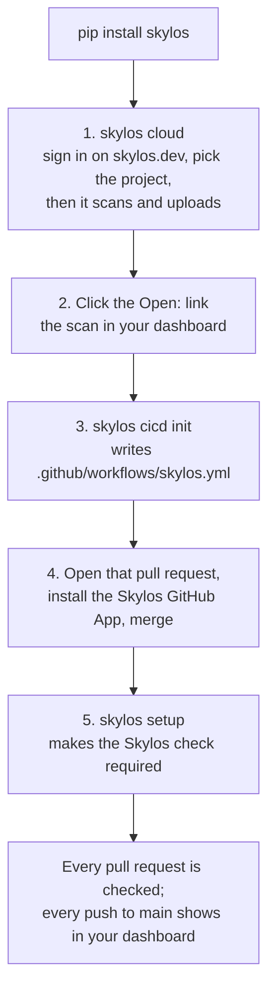

# Skylos Cloud

Skylos Cloud shows every scan online and blocks pull requests that fail. Set
it up in five steps, in this order, from your repository folder. No token to
copy.



| Step | Run or do | What happens |
|:---|:---|:---|
| 1. Upload your first scan | `skylos cloud` | Your browser opens skylos.dev. Sign in, then pick or create the project for this repo. Back in the terminal, Skylos scans with every check and uploads the findings (not your code). |
| 2. Open your results | Click the `Open:` link it prints | The scan in your dashboard: its gate result and every issue. Find it again later at [skylos.dev/dashboard](https://skylos.dev/dashboard). |
| 3. Add the pull request check | `skylos cicd init` | Writes `.github/workflows/skylos.yml` and prints the next steps: the `git` commands that open a pull request with it, and the GitHub App link. If you skipped step 1, `skylos cicd init --upload` signs you in the same way. |
| 4. Install the GitHub App, then merge | Open the GitHub App link it printed | Install the Skylos GitHub App on the repo before you merge that pull request. CI then uploads with its GitHub identity (OIDC), so there is no token or secret to add. |
| 5. Make the check required | `skylos setup` | Run it after the merge (it uses the GitHub CLI, `gh`). A pull request that fails the Skylos check can no longer merge. |

The end of step 1 looks like this:

```text
✓ Scan saved · gate (not blocking): fail
  Open: https://skylos.dev/dashboard/projects/<project>/scans/<scan>
  Saved for review. Only verified CI scans block merges and update the project verdict.
  Next: to block pull requests, run skylos cicd init and merge the workflow it writes.
```

A scan from your machine is saved for review but never blocks a merge; only
CI scans do. Upload again any time with `skylos cloud`. The rest of this page
explains step 1 in detail; [Your first gated PR](./first-gated-pr.md) walks
through steps 3 to 5.

Without Skylos Cloud, `skylos .` finds dead code and `skylos . -a` runs every
check (security, secrets, quality, AI-code defects, dependencies); neither
sends findings anywhere. The dependency check asks OSV.dev about package names
and versions.

## What `skylos cloud` does

1. The first time, it opens your browser to log in and pick the project for
   this repo.
2. When the repository has a committed `[tool.skylos.done]` table (`skylos
   setup` writes it) and your working tree is clean, it takes this commit's
   Done receipt along: the one `skylos done` already wrote for this commit,
   or it runs `skylos done` first, against the branch pull requests merge
   into, and prints its `Verdict:` line. A failed Done does not stop the
   upload; Skylos Cloud gets the receipt with its verdict. With uncommitted
   changes the receipt could not name a clean commit, so it prints
   `Done receipt not sent: commit your changes first (the receipt must name a
   clean commit)` and sends the findings alone. `--done-receipt FILE` sends a
   receipt you chose instead. In CI it does not run Done (the workflow from
   `skylos setup` has its own Done job).
3. It scans with every check (`-a`) and shows the findings, like `skylos . -a`.
   Name checks to run only those: `skylos cloud --danger --secrets`.
4. It uploads the findings and prints the gate for this branch, one link, and
   a `Sent:` line that says what reached Skylos Cloud and its standing.

What it sends: findings with file paths and code snippets of up to 7 lines
(none for secrets), the branch, the commit, the git author email of each
flagged line, and a map of your functions and classes (names, files, lines,
sizes, which calls which). Not your repository.

It takes the same scan flags as `skylos .`:

```bash
skylos cloud src --exclude build
```

## What you see

A scan from your machine, before CI is set up:

```text
✓ Scan saved · gate (not blocking): fail
  Open: https://skylos.dev/dashboard/projects/<project>/scans/<scan>
  Saved for review. Only verified CI scans block merges and update the project verdict.
  Sent: findings and the Done receipt (fail) · report only
  Next: to block pull requests, run skylos cicd init and merge the workflow it writes.
  Next: fix the issues behind the failed gate, then run skylos cloud again.
```

Once `.github/workflows/skylos.yml` exists, the `Next: … skylos cicd init`
line reads `The Skylos workflow checks pull requests in CI; this upload does
not block them.` instead.

The issues are in the findings tables printed above these lines.

`Sent:` names what reached Skylos Cloud: the findings, and the Done receipt
with its verdict (`pass`, `fail` or `unfinished`) when one went along. Without
a Done table it reads `Sent: findings · no Done table in this repo (skylos
setup adds one)`; with a table that is not committed yet it names the file.
After the `·`, the standing: a scan from your machine is `report only`. It is
shown in Skylos Cloud, but it does not publish a GitHub check, set the project
verdict or mark issues fixed. Scans that CI uploads with its GitHub identity
do, and they show the real gate:

```text
✗ Quality gate on feat/login: FAILED (was PASSED on 24 Oct 15:38 UTC, 1ba9895) · 1 critical security issue
  Open: https://skylos.dev/dashboard/projects/<project>?branch=feat%2Flogin
  Sent: findings · verified CI upload
  Next: fix the issues behind the failed gate, then run skylos cloud again.
```

The link opens the project Overview for that branch: the gate, why it failed,
and how it changed since the last run.

## Which gate, and the exit code

`skylos cloud` shows the **Skylos Cloud** quality gate: the project's policy in
Skylos Cloud. It exits `0` even when that gate fails. Add `--gate` to exit `1`
when it fails:

```bash
skylos cloud --gate
```

`skylos . --gate` is a different, local gate: it uses the limits in your
`[tool.skylos.gate]` config and uploads nothing.

## Without a terminal

With no terminal and no sign-in, `skylos cloud` stops before scanning and
exits `1`:

```text
Skylos Cloud sign-in required. Run skylos cloud PATH in a terminal without output-format flags to sign in in your browser, then retry. For unattended CI, use GitHub Actions/GitLab OIDC or a SKYLOS_TOKEN secret.
```

In GitHub Actions and GitLab CI it uses the CI identity (OIDC); other CI
systems need a `SKYLOS_TOKEN` secret. `skylos cicd init` writes a CI setup
that does this for you; see [Your first gated PR](./first-gated-pr.md). If a
CI job has no way to sign in, the upload says so: install the Skylos GitHub
App on the repository and keep `permissions: id-token: write`.

## Do I need a key to pass the gate?

No. A token only lets you upload. The gate passes when the issues that fail it
are fixed. On the paid plans (Pro, Enterprise), a workspace admin or owner can
override a failed gate in Skylos Cloud; they must give a reason, and it is
recorded with the scan.

## The other Cloud commands

You only need `skylos cloud`. The rest are for control:

| Command | Use it to |
|:---|:---|
| `skylos cloud` | scan, upload, see the gate (the one to remember) |
| `skylos cicd init` | write the CI workflow that blocks pull requests and uploads from CI |
| `skylos login` | switch to another project |
| `skylos whoami` | see which account and project you are connected to |
| `skylos project <command>` | manage the project linked to this repo |
| `skylos upload --retry` | resend uploads that did not finish |
| `skylos sync` | pull the project's Cloud policy into the repo |
| `skylos credits` | check your credit balance |
| `--upload` on a scan | the manual form of `skylos cloud`: uploads exactly the checks you picked |

Scans never upload findings unless you run `skylos cloud` or add `--upload`.
Every network request Skylos can make, and how to turn it off, is in
[Privacy and network](./privacy-and-network.md).
